# Visual Studio + OpenCV 설정 — 처음부터 끝까지

> 교재(2주차 Chapter02) p20~47 의 절차를 그대로 옮기고, **지금 내 PC에서 실제로 쓰는 값**을 나란히 적었습니다.
> 화면 캡처는 교재 그림입니다 (Visual Studio 2017 · OpenCV 4.0.0 기준). VS2022 도 메뉴 이름은 거의 같습니다.

## 한눈에 보기 — 결국 설정하는 건 네 가지

| # | 무엇 | 어디 |
|---|---|---|
| 1 | 플랫폼을 **x64** 로 | 상단 툴바 |
| 2 | **추가 포함 디렉터리** (헤더 경로) | 속성 → C/C++ → 일반 |
| 3 | **추가 라이브러리 디렉터리** (lib 폴더) | 속성 → 링커 → 일반 |
| 4 | **추가 종속성** (lib 파일 이름) | 속성 → 링커 → 입력 |

여기에 실행할 때 DLL 을 찾게 하는 설정이 하나 더 필요합니다 (→ [7단계](#7-실행-시-dll-을-못-찾을-때-교재에-없는-단계)).

---

## 0. 내 PC 값 먼저 확인하기

교재 숫자를 그대로 쓰면 안 됩니다. **버전마다 폴더·파일 이름이 다릅니다.**

| 확인할 것 | 교재 | **내 PC (실측)** |
|---|---|---|
| OpenCV 버전 | 4.0.0 | **5.0.0** |
| 설치 폴더 | `C:\opencv` | `C:\opencv` (같음) |
| vc 폴더 | `vc14`(VS2015) / `vc15`(VS2017) | **`vc16` 하나뿐** |
| lib 이름 (Debug) | `opencv_world400d.lib` | **`opencv_world500d.lib`** |
| lib 이름 (Release) | `opencv_world400.lib` | **`opencv_world500.lib`** |
| Visual Studio | 2017 | **2022 Community 17.14** |

**직접 확인하는 법** — 탐색기로 이 폴더를 엽니다.

```
C:\opencv\build\x64\
```

- 그 안에 있는 폴더 이름이 내 `vc` 번호입니다 (`vc16` 등)
- 다시 `vc16\lib` 로 들어가면 `opencv_world500.lib` 처럼 **실제 파일 이름**이 보입니다
- 숫자 규칙: `world` 뒤 세 자리 = OpenCV 버전 (4.0.0 → `400`, 5.0.0 → `500`), **끝의 `d` = Debug 용**

> 💡 `vc16` 은 원래 VS2019 용이지만 VS2022 에서도 그대로 씁니다. MSVC 가 호환을 유지해서요.

---

## 1. OpenCV 압축 풀기 (이미 되어 있으면 건너뛰기)

내려받은 `opencv-5.0.0-windows.exe` 를 실행하면 설치 마법사가 아니라 **압축 해제 창**이 뜹니다.

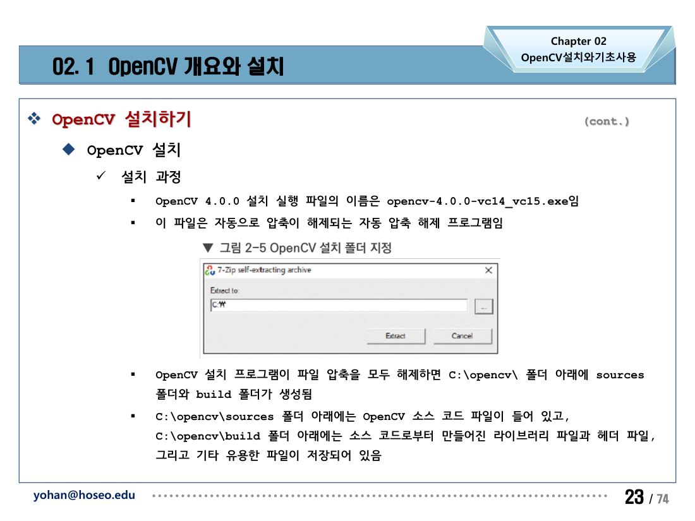

`Extract to:` 칸에 **`C:\`** 를 넣고 Extract.

> ⚠️ `C:\opencv` 가 아니라 **`C:\`** 입니다. 압축 안에 이미 `opencv` 폴더가 들어 있어서,
> `C:\opencv` 로 지정하면 `C:\opencv\opencv\` 가 되어 버립니다.

다 풀리면 이런 구조가 됩니다.

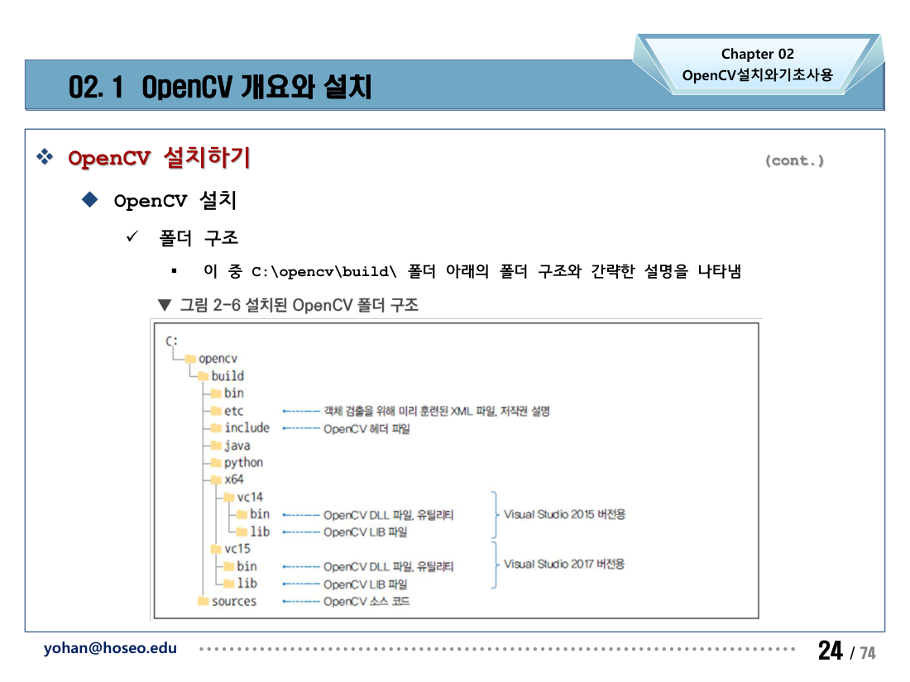

| 폴더 | 들어 있는 것 |
|---|---|
| `build\include` | **헤더 파일** (→ 2번에서 씀) |
| `build\x64\vc16\lib` | **lib 파일** (→ 3·4번에서 씀) |
| `build\x64\vc16\bin` | **DLL 파일** (→ 7번에서 씀) |
| `sources` | 소스 코드 (안 씀) |

---

## 2. 환경 변수 `OPENCV_DIR` 만들기

경로를 매번 길게 치지 않으려고 변수를 하나 만듭니다. **교재가 이 방식을 씁니다.**

1. 키보드 **`Windows 키` + `S`** → `시스템 환경 변수 편집` 입력 → 실행
2. **고급** 탭 → 아래쪽 **[환경 변수]** 버튼
3. 위쪽 **사용자 변수** 영역에서 **[새로 만들기]**
4. 입력:

| 칸 | 값 |
|---|---|
| 변수 이름 | `OPENCV_DIR` |
| 변수 값 | `C:\opencv\build` |

> ⚠️ `C:\opencv` 가 아니라 **`build` 까지** 넣습니다.
> ⚠️ **시스템 변수**가 아니라 위쪽 **사용자 변수** 쪽 [새로 만들기] 입니다.

아래가 교재의 실제 화면입니다. 왼쪽 위 사용자 변수에 `OPENCV_DIR`, 오른쪽이 Path 편집 창입니다.

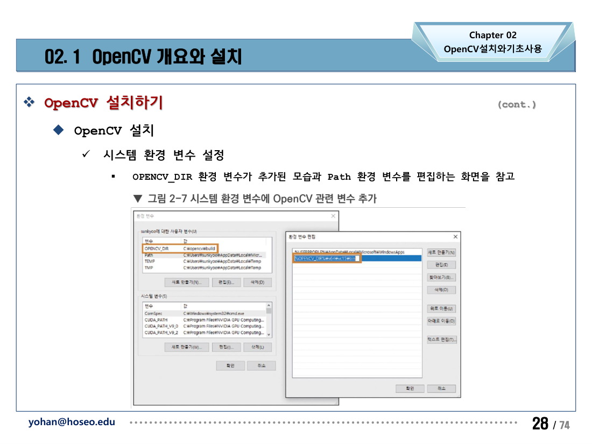

### 같이 하면 좋은 것 — PATH 에 bin 추가

위 그림 오른쪽 창입니다. 같은 창의 사용자 변수에서 **`Path`** 를 고르고 [편집] → [새로 만들기] → 아래 값을 추가합니다.

```
%OPENCV_DIR%\x64\vc16\bin
```

이걸 해 두면 **7단계(DLL 문제)를 모든 프로젝트에서 한 번에** 해결합니다.
(교재는 `vc15` 라고 적혀 있지만 내 PC 는 `vc16` 입니다.)

> ⚠️ 환경 변수를 바꾼 뒤에는 **이미 열려 있는 Visual Studio 와 명령 프롬프트에 반영되지 않습니다.**
> VS 를 완전히 껐다 켜야 합니다.

### 제대로 됐는지 확인

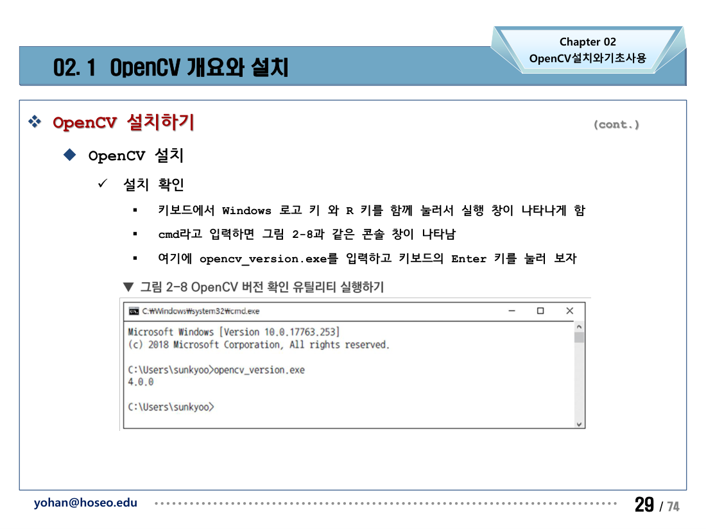

명령 프롬프트(`cmd`)를 **새로 열고**:

```bat
opencv_version.exe
```

버전 숫자가 찍히면 성공입니다. "명령을 찾을 수 없음" 이 나오면 PATH 가 안 잡힌 것이니, 전체 경로로 확인합니다.

```bat
C:\opencv\build\x64\vc16\bin\opencv_version.exe
```

---

## 3. 새 프로젝트 만들기

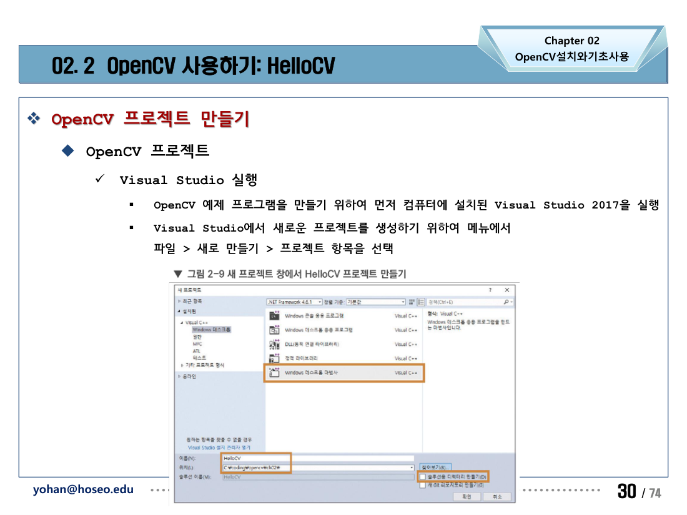

**파일 → 새로 만들기 → 프로젝트** → **Windows 데스크톱 마법사** 선택 → 이름·위치 입력 → [확인]

> VS2022 는 왼쪽 트리가 없어졌습니다. 위쪽 **검색창에 `Windows 데스크톱 마법사`** 를 쳐서 찾으세요.
> (`빈 프로젝트` 템플릿을 골라도 결과는 같습니다.)

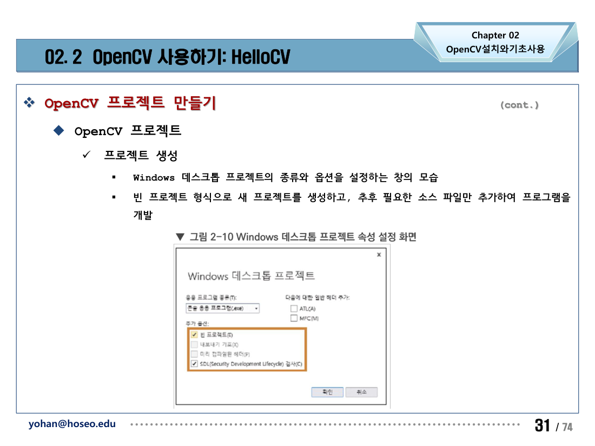

다음 창에서:

| 항목 | 값 |
|---|---|
| 응용 프로그램 종류 | **콘솔 응용 프로그램 (.exe)** |
| 추가 옵션 | **빈 프로젝트** 체크 |

---

## 4. 플랫폼을 x64 로 바꾸기 ★

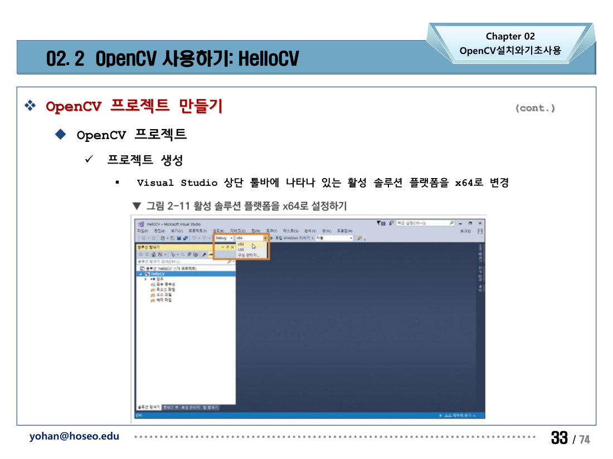

상단 툴바에서 `Debug` 옆의 플랫폼 드롭다운을 열어 **`x64`** 를 고릅니다.

> ⚠️ **기본값이 `x86`(Win32) 이라 반드시 바꿔야 합니다.**
> 우리가 설치한 OpenCV 는 64비트(`x64` 폴더) 전용이라, x86 상태로는 아무리 설정해도 링크가 안 됩니다.
> 뒤에 나오는 속성 설정은 **지금 고른 플랫폼에만 적용**되므로 순서가 중요합니다.

---

## 5. 소스 파일 추가하기

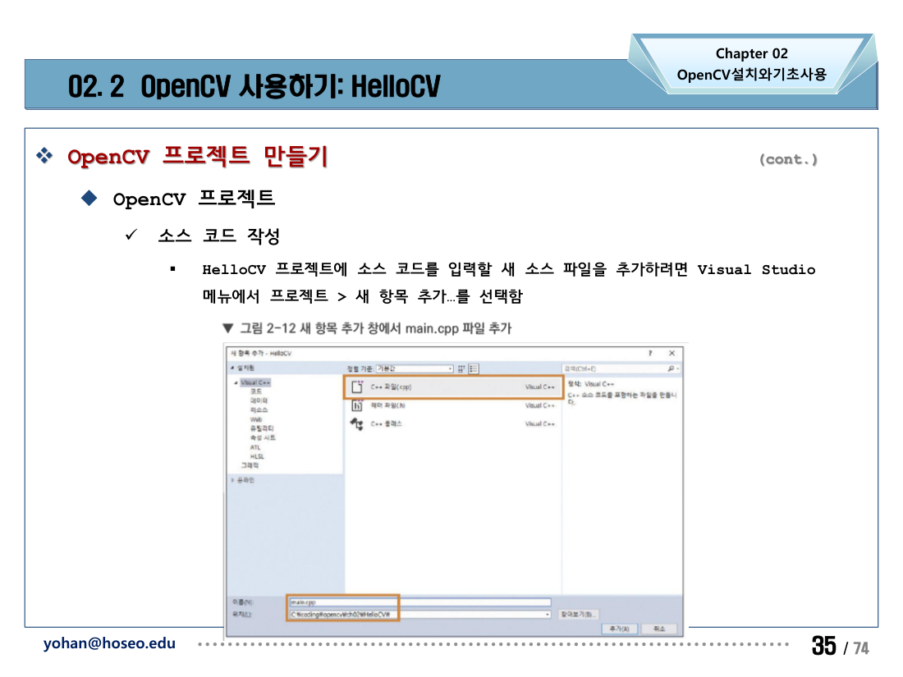

솔루션 탐색기 → **소스 파일** 우클릭 → **추가 → 새 항목** → **C++ 파일(.cpp)** → 이름 `main.cpp` → [추가]

코드를 넣어 보면 빨간 밑줄이 뜹니다. 아직 설정을 안 했으니 정상입니다.

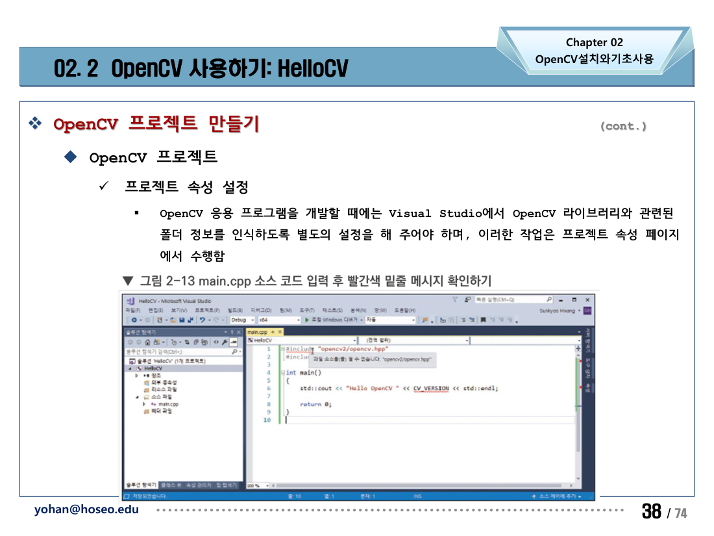

> `#include "opencv2/opencv.hpp"` 에 **"열 수 없습니다"** 가 뜨는 건 → 다음 단계(포함 디렉터리)로 해결됩니다.

---

## 6. 속성 3곳 설정 ★★★

솔루션 탐색기에서 **프로젝트 이름 우클릭 → 속성**.

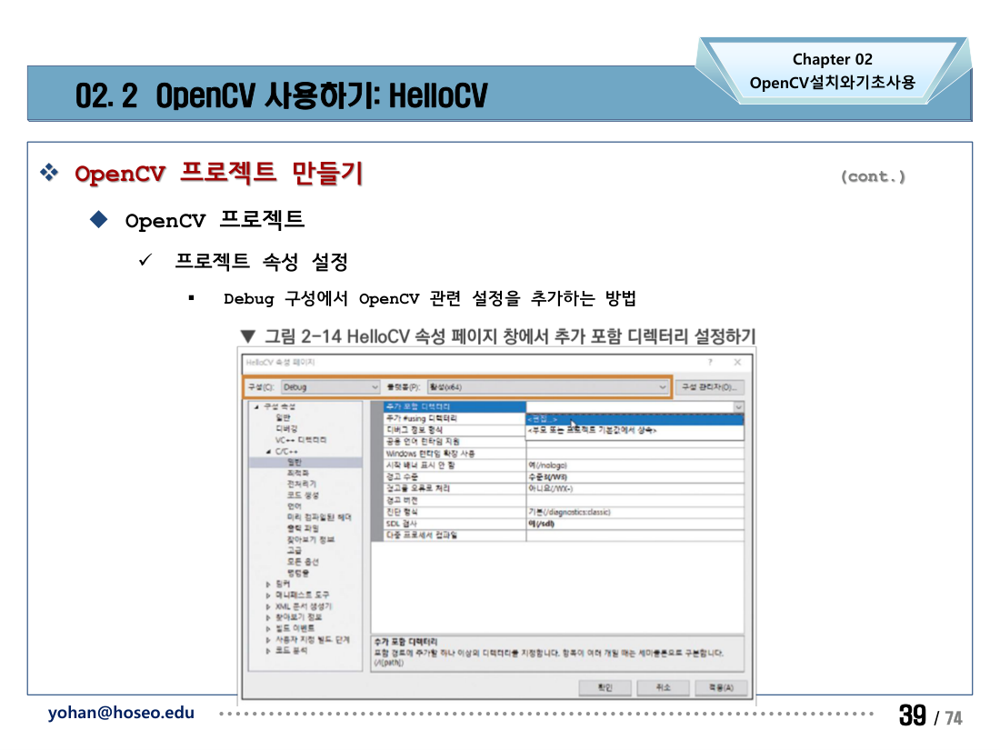

> ⚠️ **창 맨 위의 `구성`과 `플랫폼` 을 먼저 확인하세요.**
> **구성: `Debug`, 플랫폼: `x64`** 여야 합니다.
> 플랫폼이 `Win32` 인 상태로 값을 넣으면 x64 빌드에는 **전혀 반영되지 않습니다.**
> "분명히 설정했는데 안 돼요" 의 가장 흔한 원인입니다.

### ① 추가 포함 디렉터리 — 헤더를 찾게 한다

**C/C++ → 일반 → 추가 포함 디렉터리** → 오른쪽 드롭다운 → **`<편집...>`**

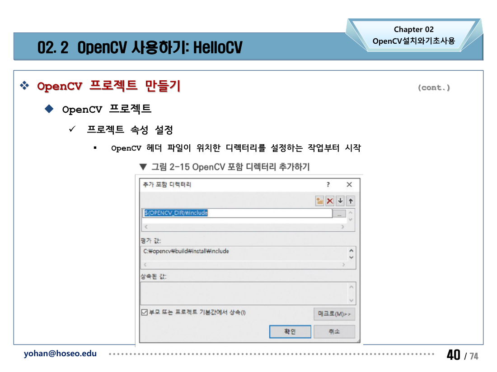

```
$(OPENCV_DIR)\include
```

> `$(OPENCV_DIR)` 은 2단계에서 만든 환경 변수입니다. 절대 경로 `C:\opencv\build\include` 를 직접 써도 똑같이 동작합니다.
> 아래 **'부모 또는 프로젝트 기본값에서 상속' 체크는 켜 둔 채로** 둡니다.

### ② 추가 라이브러리 디렉터리 — lib 폴더를 찾게 한다

**링커 → 일반 → 추가 라이브러리 디렉터리** → `<편집...>`

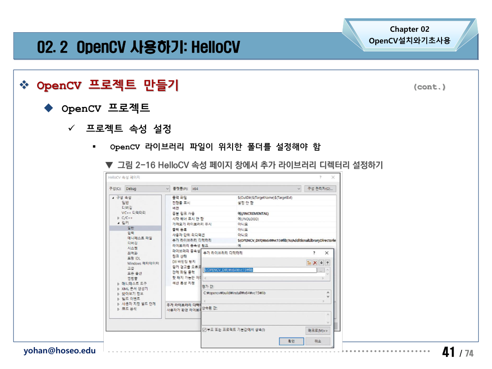

```
$(OPENCV_DIR)\x64\vc16\lib
```

> 교재 화면은 `vc15` 입니다. **0단계에서 확인한 내 폴더 이름(`vc16`)** 으로 쓰세요.

### ③ 추가 종속성 — lib 파일 이름을 알려준다

**링커 → 입력 → 추가 종속성** → `<편집...>`

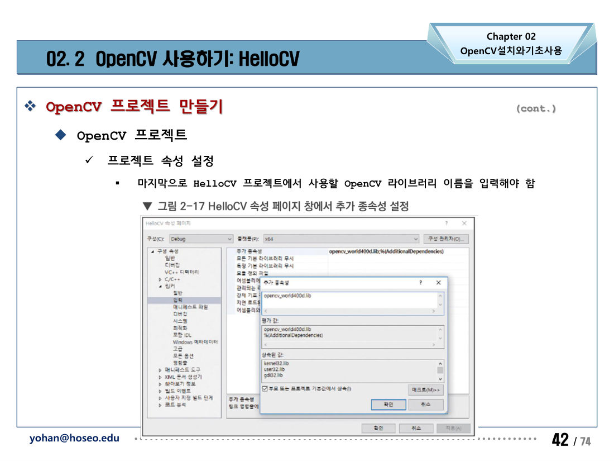

```
opencv_world500d.lib
```

> ⚠️ **`.lib` 만 넣습니다. `.dll` 을 넣으면 `LNK1104` 로 빌드가 깨집니다.**
> ⚠️ 끝의 **`d` 는 Debug 용** 표시입니다. Debug 구성에 `d` 없는 lib 를 넣으면 링크는 통과해도 실행 중에 엉뚱하게 죽습니다.

### 요약표 — 새 프로젝트 만들 때마다 이 세 줄

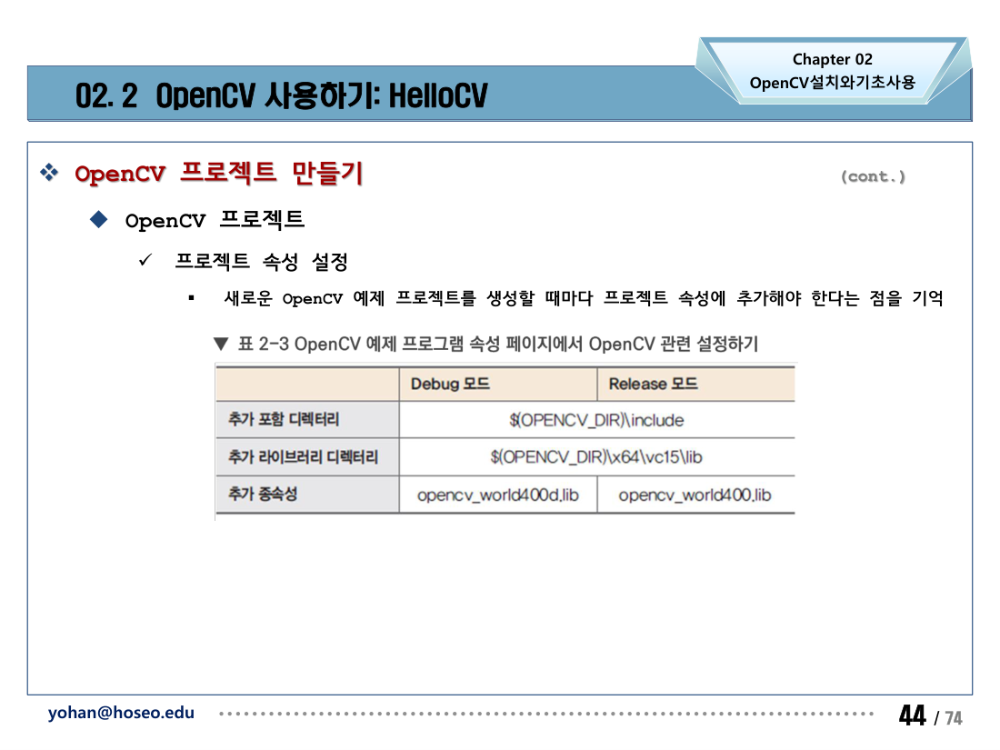

| 속성 | Debug | Release |
|---|---|---|
| 추가 포함 디렉터리 | `$(OPENCV_DIR)\include` | ← 같음 |
| 추가 라이브러리 디렉터리 | `$(OPENCV_DIR)\x64\vc16\lib` | ← 같음 |
| **추가 종속성** | `opencv_world500d.lib` | `opencv_world500.lib` (**d 없음**) |

> ⚠️ **Release 는 따로 설정해야 합니다.** 구성 드롭다운을 `Release` 로 바꾸면 세 칸이 **다시 비어 있습니다.**
> 지금 쓰고 계신 `cvTest2` 프로젝트도 **Debug|x64 에만** 설정돼 있어서, Release 로 바꾸면 바로 에러가 납니다.
> **시험 때는 그냥 Debug 로 두세요.**

---

## 7. 실행 시 DLL 을 못 찾을 때 (교재에 없는 단계)

빌드는 됐는데 실행하자마자 이런 창이 뜨는 경우입니다.

```
opencv_world500d.dll 을(를) 찾을 수 없어 코드 실행을 계속할 수 없습니다.
```

2단계에서 PATH 에 `bin` 을 넣었으면 안 납니다. 안 넣었거나 급할 때는 **프로젝트 단위로** 해결합니다.

**속성 → 구성 속성 → 디버깅 → 환경** 칸에 한 줄:

```
PATH=C:\opencv\build\x64\vc16\bin;%PATH%
```

> 이 설정은 `.vcxproj.user` 파일에 **구성별로** 저장됩니다. Release 로 바꾸면 다시 넣어야 합니다.
> 지금 `cvTest2` 가 이 방식으로 돌아가고 있습니다.

> ⚠️ DLL 하나만 프로젝트 폴더에 복사하는 식으로 때우지 마세요.
> 동영상(`VideoCapture`)을 쓰면 `opencv_videoio_ffmpeg500_64.dll` 도 같이 필요해서, **동영상 코드에서만 조용히 실패**합니다.

---

## 8. 빌드하고 실행하기

1. **빌드 → 솔루션 빌드** — 설정이 맞으면 빨간 밑줄이 사라집니다
2. **디버그 → 디버그하지 않고 시작** (`Ctrl+F5`)

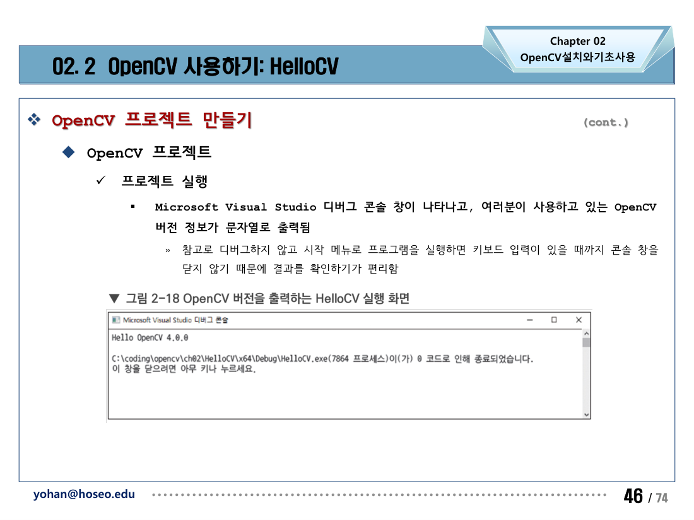

콘솔에 버전이 찍히면 **설정 끝**입니다.

> 💡 `디버깅 시작`(F5) 말고 **`디버그하지 않고 시작`(Ctrl+F5)** 을 쓰면 창이 바로 닫히지 않아 결과를 볼 수 있습니다.

### 이미지 파일은 어디에 두나

`imread("lenna.bmp")` 처럼 파일 이름만 쓰면 **`.vcxproj` 가 있는 폴더**에서 찾습니다. `.sln` 폴더가 아닙니다.

```
MyProject\
  MyProject.sln
  MyProject\          ← 여기
    MyProject.vcxproj
    main.cpp
    lenna.bmp
```

---

## 에러로 어디를 고칠지 찾기

**에러가 나는 시점**으로 세 군데 중 어디가 틀렸는지 알 수 있습니다.

| 언제 터지나 | 에러 | 어디를 고치나 |
|---|---|---|
| **컴파일** 중 | `opencv2/opencv.hpp 를 열 수 없습니다` | ① **추가 포함 디렉터리** |
| **링크** 중 | `LNK1104: ...lib 를 열 수 없습니다` | ② **추가 라이브러리 디렉터리** (또는 lib 이름의 버전 숫자) |
| **링크** 중 | `LNK2019: 확인할 수 없는 외부 기호` | ③ **추가 종속성** (비었거나 이름이 틀림) |
| **실행** 직후 | `...dll 을 찾을 수 없어` | ⑦ **PATH / 디버깅 환경** |

### 그 밖에

| 증상 | 원인 |
|---|---|
| 설정했는데 그대로 에러 | 속성 창의 **플랫폼이 Win32** 였다 (x64 로 바꾸고 다시) |
| Release 로 바꿨더니 에러 | Release 구성은 **설정이 비어 있다** (6단계 요약표) |
| `LNK1104` 인데 경로는 맞음 | 추가 종속성에 **`.dll` 을 넣었다** — `.lib` 만 |
| `LNK2005: main이 이미 정의` | `main()` 있는 .cpp 가 둘 이상 → 안 쓰는 파일 우클릭 → 속성 → **빌드에서 제외: 예** |
| 창이 바로 닫힘 | `waitKey(0);` 가 없다 |
| `Image load failed!` | 이미지가 `.vcxproj` 폴더에 없다 (경로에 한글이 있어도 못 읽음) |
| 한글 주석 깨짐 / `C4819` | 파일을 **UTF-8(BOM 포함)** 으로 저장 |

---

## 내 PC 실제 설정값 (그대로 베껴 쓰기)

`cvTest2` 프로젝트에서 실제로 동작 중인 값입니다. (Debug · x64)

```
추가 포함 디렉터리       C:\opencv\build\include
추가 라이브러리 디렉터리   C:\opencv\build\x64\vc16\lib
추가 종속성              opencv_world500d.lib
디버깅 → 환경            PATH=C:\opencv\build\x64\vc16\bin;%PATH%
플랫폼 도구 집합          v143 (Visual Studio 2022)
환경 변수                OPENCV_DIR = C:\opencv\build
```

**학교 컴퓨터는 버전이 다를 수 있습니다.** 0단계로 `vc` 번호와 `lib` 이름부터 확인하고, 위 값에서 그 두 가지만 바꿔 넣으세요.
